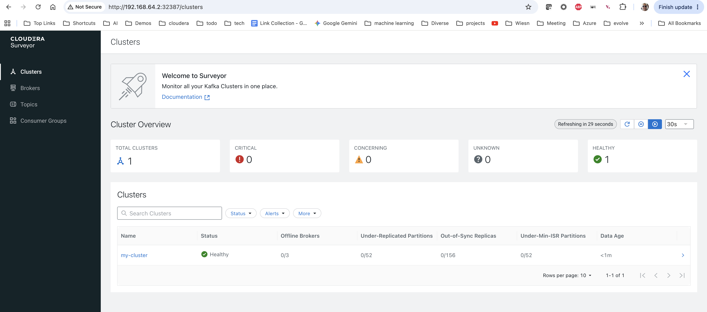
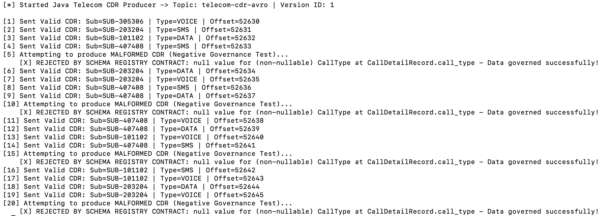
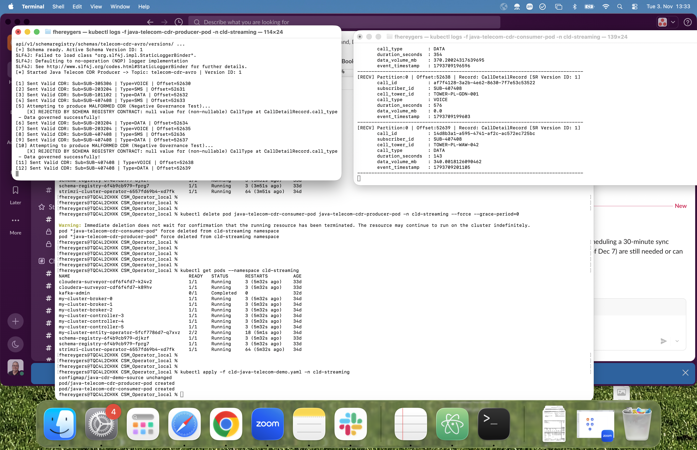

# Setup of Cloudera Streams Messaging 

Following steps deploy CSM on Minikube running on your Macbook.

## Pre-requisites

- Following packages need to be installed: Docker (or podman), Minikube, helm
- valid cloudera license and its corresponding user name and password, generated on www.cloudera.com in the download section.

If you clone this repository and also add the license file in the directory, the below commands should work without much changes.

In case of podman make sure that the virtual machine is big enough.

```
podman machine init --cpus 6 --memory 14336
podman machine start
```

## Setup

Open a terminal window and Spin up Minikube with enough resources for the full stack

```
minikube start --cpus 4 --memory 12288
```
Define following environmental variables that will be used in the subsequent commands

```
export CLOUDERA_LICENSE_USER="<Your_User_Name>"
export CLOUDERA_LICENSE_PASSWORD="<Your_User_password>"
```
## Installing Strimzi with Helm

Create a namespace in your Kubernetes cluster

```
kubectl create namespace cld-streaming
```
Log in into the cloudera docker registry with helm

```
helm registry login container.repository.cloudera.com -u "$CLOUDERA_LICENSE_USER" -p "$CLOUDERA_LICENSE_PASSWORD"
```
Create a Kubernetes secret containing your cloudera credentials

```
kubectl create secret docker-registry cloudera-creds \
  --namespace cld-streaming \
  --docker-server=container.repository.cloudera.com \
  --docker-username="$CLOUDERA_LICENSE_USER" \
  --docker-password="$CLOUDERA_LICENSE_PASSWORD" 
```
Install Strimzi with helm install
```
helm install strimzi-cluster-operator \
  --namespace cld-streaming \
  --set 'image.imagePullSecrets[0].name=cloudera-creds' \
  --set-file clouderaLicense.fileContent=<Your_license_file_name> \
  --set watchAnyNamespace=true \
  oci://container.repository.cloudera.com/cloudera-helm/csm-operator/strimzi-kafka-operator \
  --version 1.6.0-b99
```

Verify your installation
```
kubectl get deployments --namespace cld-streaming
```

```
kubectl get pods --namespace cld-streaming
```

## Deploy a kafka cluster

The repository contains following 3 yaml files with a configuration as documented in the product documentation:
kafka.yaml, broker.yaml, controller.yaml (Refer to this [documentation link](https://docs.cloudera.com/csm-operator/1.6/kafka-deploy-configure/topics/csm-op-deploying-kafka.html) for a detailed discussion on configuration parameters)

Deploy the cluster

```
kubectl apply \
  --filename Kafka.yaml,broker.yaml,controller.yaml \
  --namespace cld-streaming
```

Verify that the pods are created.

```
kubectl get pods --namespace cld-streaming
```


## Validate the kafka cluster

Create a topic 

```
IMAGE=$(kubectl get pod my-cluster-broker-0  --namespace cld-streaming --output jsonpath='{.spec.containers[0].image}')
kubectl run kafka-admin -it \
  --namespace cld-streaming \
  --image=$IMAGE \
  --rm=true \
  --restart=Never \
  --command -- /opt/kafka/bin/kafka-topics.sh \
    --bootstrap-server my-cluster-kafka-bootstrap:9092 \
    --create \
    --topic my-topic
```

Produce messages to the topic by starting the starting the producer and typing a few words

```
kubectl run kafka-producer -it \
  --namespace cld-streaming \
  --image=$IMAGE \
  --rm=true \
  --restart=Never \
  --command -- /opt/kafka/bin/kafka-console-producer.sh \
    --bootstrap-server my-cluster-kafka-bootstrap:9092 \
    --topic my-topic
```

```
>hello
>csm
>operator
>^C
```

Consume the messages

```
kubectl run kafka-consumer -it \
  --namespace cld-streaming \
  --image=$IMAGE \
  --rm=true \
  --restart=Never \
  --command -- /opt/kafka/bin/kafka-console-consumer.sh \
    --bootstrap-server my-cluster-kafka-bootstrap:9092 \
    --topic my-topic \
    --from-beginning
```

## Deploy Surveyor

Obtain the bootstrap servers

```
kubectl get kafka my-cluster -n cld-streaming -o jsonpath='{.status.listeners[?(@.name=="plain")].bootstrapServers}'
```

Create a file surveyor.yaml with below settings, for bootstrapservers take the value you just obtained with the previous command

```
clusterConfigs:
  clusters:
    - clusterName: my-cluster
      tags:
        - csm1.6
      bootstrapServers: my-cluster-kafka-bootstrap.cld-streaming.svc:9092 
      adminOperationTimeout: PT1M
      authorization:
        enabled: false
      commonClientConfig:
        security.protocol: PLAINTEXT
surveyorConfig:
  surveyor:
    authentication:
      enabled: false
tlsConfigs:
  enabled: false
```

Install cloudera Surveyor with helm install

```
helm install cloudera-surveyor \
  --namespace cld-streaming \
  --values surveyor.yaml \
  --set 'image.imagePullSecrets=cloudera-creds' \
  --set-file clouderaLicense.fileContent=<Your_license_file_name>  \
  oci://container.repository.cloudera.com/cloudera-helm/csm-operator/surveyor \
  --version 1.6.0-b99
```


```
minikube service cloudera-surveyor-service --namespace cld-streaming
```

Now all settings can be made over the UI.


<br/>

<br/>


## Deploy Schema Registry

Create the sr-values.yaml files with following values

```
tls:
  enabled: false
authentication:
  oauth:
    enabled: false
authorization:
  simple:
    enabled: false
database:
  type: in-memory
service:
  type: NodePort
```

Execute following helm command to install Schema Registry

```
helm install schema-registry \
--namespace cld-streaming \
--version 1.6.0-b99 \
--values sr-values.yaml \
--set "image.imagePullSecrets[0].name=cloudera-creds" \
oci://container.repository.cloudera.com/cloudera-helm/csm-operator/schema-registry 
```

## Deploy a telecommunication use case on the deployed kafka cluster and Schema Registry

**Java Version**

The following telecommunication use case demonstrates the streaming and processing of Call Detail Records (CDRs) using official Java Kafka clients and Cloudera Schema Registry:

- K8s Operator Abstraction: Topic management, Kafka brokers, and Cloudera Schema Registry run natively in Kubernetes under the cld-streaming namespace, orchestrated via Cloudera Streams Messaging (CSM) Operator CRDs.
- Dynamic Schema Discovery & Reflection: Both Producer and Consumer communicate over HTTP REST with Cloudera Schema Registry using the Cloudera SerDe Wire Protocol (0x01 magic byte + 8-byte big-endian schemaVersionId header). The Consumer operates completely schema-agnostic, dynamically introspecting fields and values directly from the registered Avro schema definition without hardcoded record structures.
- Client-Side Data Quality & Governance: The Producer enforces the schema contract locally using Apache Avro’s GenericRecordBuilder. Schema violations—such as unsupported CallType enum symbols (INVALID_5G_VIDEO)—are caught client-side, blocking malformed events from polluting the Kafka topic.
- End-to-End Generic Deserialization: The Consumer decodes wire headers, fetches and caches active schema definitions by version ID from the registry, and dynamically reads binary Avro payloads into GenericRecord objects.

The Java application includes the following core components and capabilities:
- Lifecycle Management & Schema Registration (ensureSchemaExists): Probes the Cloudera Schema Registry via Java's native HttpClient for the telecom-cdr-avro schema. If missing, it creates the schema metadata container and registers Version 1, verifying and returning the active schemaVersionId.
- Cloudera Wire Protocol Byte Management (packClouderaHeader / ByteBuffer Parsing): Handles binary byte packing and slicing using java.nio.ByteBuffer to prefix every serialized Avro byte array with Cloudera’s 9-byte header (0x01 magic byte followed by an 8-byte Big-Endian Long Version ID).
- Negative Contract Testing & Event Synthesis (runProducer): Synthesizes randomized valid CDR events across voice, SMS, and data services. Every fifth iteration intentionally attempts to emit an invalid record containing an illegal enum value, validating client-side governance exception handling before Kafka dispatch.
- Dynamic Consumer Pipeline (runConsumer): Subscribes to telecom-cdr-avro, strips the 9-byte wire header, and queries the registry dynamically to load previously unseen schemas into an in-memory ConcurrentHashMap cache.
- Schema-Driven Field Introspection: Deserializes binary payloads using GenericDatumReader and iterates over remoteSchema.getFields(), printing record attributes dynamically based on whatever fields exist in the registry schema version.


Create a kafka topic **telecom-cdr-avro** in the cluster

```
IMAGE=$(kubectl get pod my-cluster-broker-0  --namespace cld-streaming --output jsonpath='{.spec.containers[0].image}')
kubectl run kafka-admin -it \
  --namespace cld-streaming \
  --image=$IMAGE \
  --rm=true \
  --restart=Never \
  --command -- /opt/kafka/bin/kafka-topics.sh \
    --bootstrap-server my-cluster-kafka-bootstrap:9092 \
    --create \
    --topic telecom-cdr-avro  
```


Start the kafka producer pod and the kafka consumer pod with following command

```
kubectl apply -f cld-java-telecom-demo.yaml -n cld-streaming  
```

To display the producer output, open a separate terminal window and run
```
kubectl logs -f java-telecom-cdr-producer-pod -n cld-streaming
```

<br/>

<br/>

To display the consumer output, open a separate terminal window and run


```
kubectl logs -f java-telecom-cdr-consumer-pod -n cld-streaming
```

<br/>

<br/>

To stop the kafka clients run following command

```
kubectl delete -f cld-java-telecom-demo.yaml -n cld-streaming 
```


