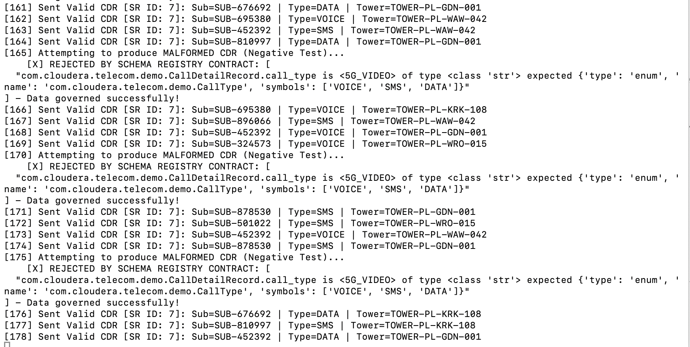
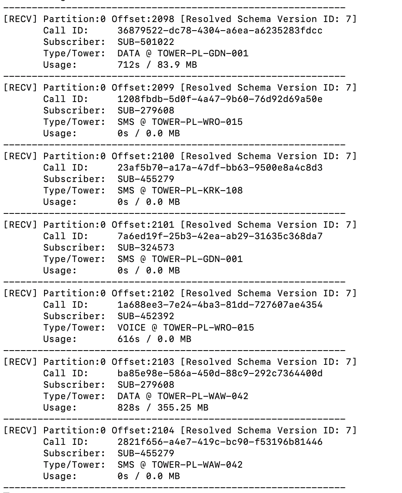

## Deploy a telecommunication use case on the deployed kafka cluster and Schema Registry

**This directory includes the original solution, based upon python. The main solution is now based upon Java

Following telecommunication use case shows the processing of Call Detail Records using kafka and cloudera Schema Registry:
- K8s Operator Abstraction: Topic management and streaming infrastructure running natively via CSM Operator CRDs.
- Dynamic Schema Resolution: Both Producer and Consumer dynamically communicate over HTTP REST with Cloudera Schema Registry using the Cloudera SerDe Wire Protocol (0x01 magic byte + 8-byte schemaVersionId header).
- Data Quality & Governance: The Producer client validates payloads locally against Schema Version ID 3 (telecom-cdr-avro), preventing invalid events (e.g., corrupted call_type enums) from polluting Kafka.
- End-to-End Deserialization: The Consumer resolves Schema Version ID 3 dynamically from the registry and parses incoming Avro binary byte payloads back into structured Telecom CDR records.

The python code includes follwoing capabilities:
- Schema Resolution & Dynamic Creation (ensure_schema_exists): Checks whether telecom-cdr-avro exists in the Cloudera Schema Registry via REST API. If found, it fetches the latest active Version ID and Avro definition; if missing, it registers both the schema metadata and Version 1 automatically using a POST request.
- Cloudera SerDe Protocol Headers (pack_cloudera_header / unpack_cloudera_header): Implements binary byte packing/unpacking using struct.pack(">Bq", ...) to prepending a 9-byte wire header (0x01 magic byte + 8-byte big-endian schemaVersionId) to all serialized Avro payloads.
- CDR Event Generators (generate_valid_cdr / generate_malformed_cdr): Provides mock data generators for realistic Telecom events (VOICE, SMS, DATA) and intentionally bad events (unsupported 5G_VIDEO enum value, non-numeric duration string) used to demonstrate data governance contract enforcement.
- Producer Pipeline (run_producer): Runs an infinite streaming loop that validates CDR records against the schema locally via fastavro.validate. Valid records are serialized into binary Avro, tagged with the Cloudera wire header, and published to Kafka; invalid records are caught and rejected client-side before reaching the brokers.
- Consumer Pipeline (run_consumer): Subscribes to the Kafka topic, extracts the 8-byte schemaVersionId from incoming message headers, dynamically fetches and caches un-cached schemas from the Registry, and deserializes the Avro binary payloads back into structured JSON CDR records.


Start the kafka producer pod and the kafka consumer pod with following command

```
kubectl apply -f cdr-demo-pod.yaml -n cld-streaming  
```

To display the producer output, open a separate terminal window and run
```
kubectl logs -f telecom-cdr-producer-pod -n cld-streaming
```

<br/>

<br/>

To display the consumer output, open a separate terminal window and run
```
kubectl logs -f telecom-cdr-consumer-pod -n cld-streaming
```

<br/>

<br/>

To stop the kafka clients run following command

```
kubectl delete -f cdr-demo-pod.yaml -n cld-streaming 
```


