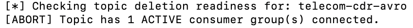
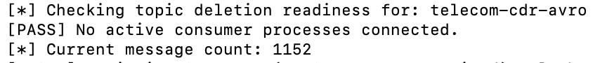
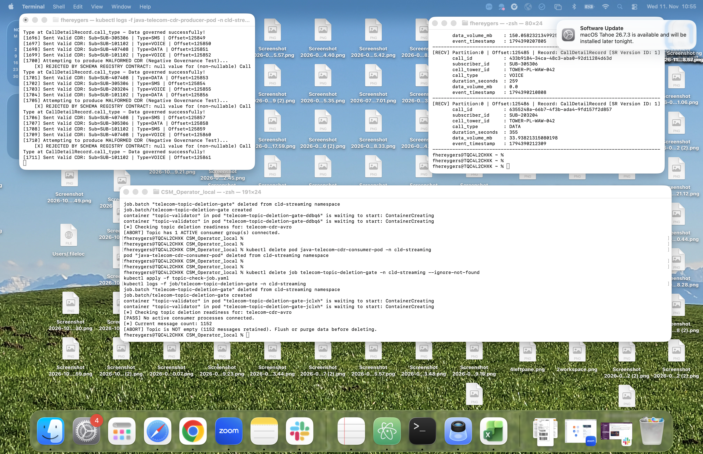

# checks on topics before deleting

When deleting kafka topics, it is good practice to also make sure that there are no producers and consumers anymore.

Below you find an exercise, that tests whether there are still active consumer groups and whether there are events in the topic. 
This test can be build into business logic of a self service portal, hat would allow end users to administrate their own topics.

Instead of using the standard kafka CLI tool, I opted for sending API requests to the surveyor, as this capability already has already all information available
Following code is executing the checks:

```
SURVEYOR_BASE="http://cloudera-surveyor-service.cld-streaming.svc.cluster.local:8080/api/v1/clusters/my-cluster"
TOPIC="telecom-cdr-avro"

echo "[*] Checking topic deletion readiness for: ${TOPIC}"

# 1. Consumer Group Check
ACTIVE_CONSUMERS=$(curl -s "${SURVEYOR_BASE}/consumer-groups?topic=${TOPIC}" | jq '[.data[]? | select(.state == "STABLE" or (.membersCount // 0) > 0)] | length')
if [ "$ACTIVE_CONSUMERS" -gt 0 ]; then
  echo "[ABORT] Topic has ${ACTIVE_CONSUMERS} ACTIVE consumer group(s) connected."
  exit 1
fi
echo "[PASS] No active consumer processes connected."

# 2. Non-Empty Check (Total Messages)
MSG_COUNT=$(curl -s "${SURVEYOR_BASE}/topics/${TOPIC}" | jq -r '.messageCount.value // 0')
echo "[*] Current message count: ${MSG_COUNT}"

if [ "$MSG_COUNT" -gt 0 ]; then
  echo "[ABORT] Topic is NOT empty (${MSG_COUNT} messages retained). Flush or purge data before deleting."
  exit 1
fi

echo "[PASS] Topic is completely empty (0 messages) and has 0 active consumers. Safe to delete."
```

Make sure that both producer pod and consumer pod are started with following command

```
kubectl apply -f cld-java-telecom-demo.yaml -n cld-streaming  
```

Run the topic check a first time

```
kubectl delete job telecom-topic-deletion-gate -n cld-streaming --ignore-not-found
kubectl apply -f topic-check-job.yaml
kubectl logs -f job/telecom-topic-deletion-gate -n cld-streaming
```

You should get following result

<br/>

<br/>


Now stop the consumer to get to the next check in the code

```
kubectl delete pod java-telecom-cdr-consumer-pod -n cld-streaming
```

```
kubectl delete job telecom-topic-deletion-gate -n cld-streaming --ignore-not-found
kubectl apply -f topic-check-job.yaml
kubectl logs -f job/telecom-topic-deletion-gate -n cld-streaming
```

You should get following result

<br/>

<br/>

Now stop the producer and flush the topic

```
kubectl delete pod java-telecom-cdr-producer-pod -n cld-streaming
```

```
kubectl exec -it my-cluster-broker-0 -n cld-streaming -c kafka -- sh -c '
cat <<EOF > /tmp/purge-topic.json
{
  "partitions": [
    {
      "topic": "telecom-cdr-avro",
      "partition": 0,
      "offset": -1
    }
  ],
  "version": 1
}
EOF
bin/kafka-delete-records.sh --bootstrap-server localhost:9092 --offset-json-file /tmp/purge-topic.json
'
```

Wait for somewhat 1 minute for the surveyor to pick on the event amount

```
kubectl delete job telecom-topic-deletion-gate -n cld-streaming --ignore-not-found
kubectl apply -f topic-check-job.yaml
kubectl logs -f job/telecom-topic-deletion-gate -n cld-streaming
```

You should get following result

<br/>

<br/>


